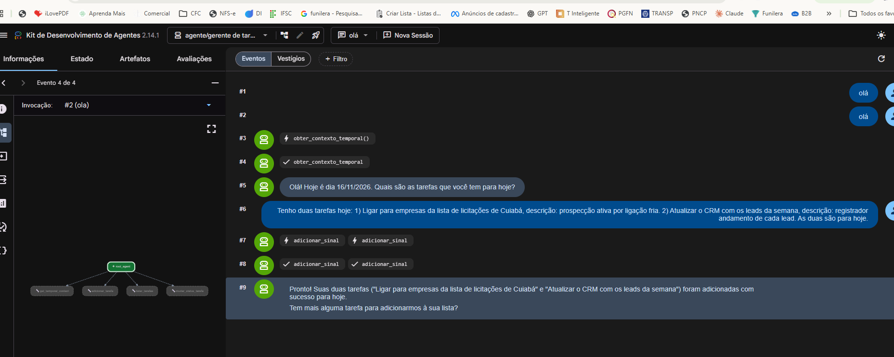
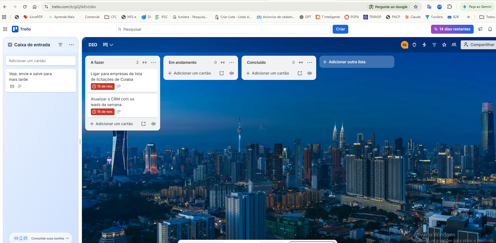
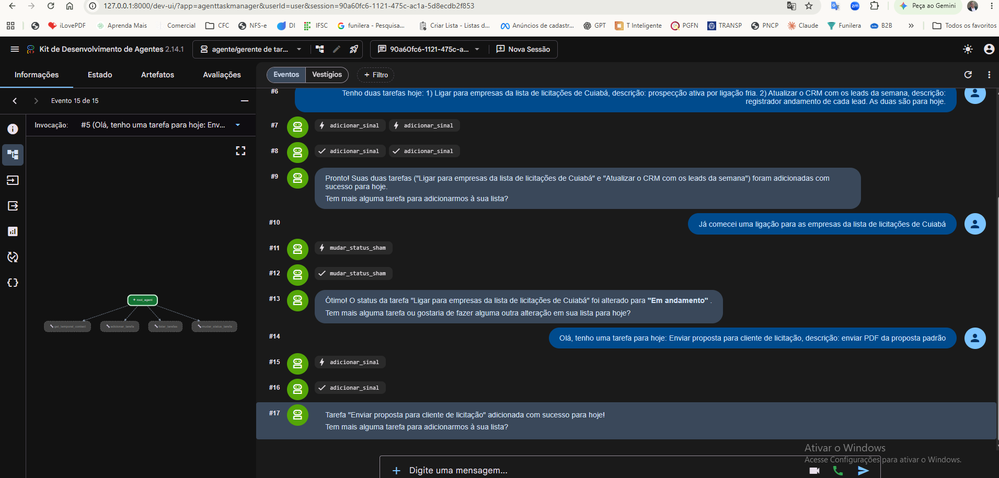
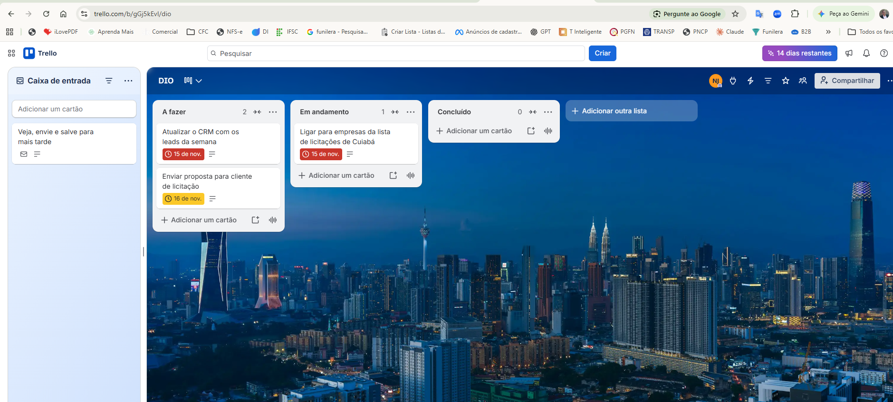

# 🗂️ Agente Organizador de Tarefas no Trello

Agente de IA em Python que **conversa com você, pergunta as tarefas do dia e organiza tudo sozinho num quadro do Trello**: cria os cartões, lista as tarefas e move cada uma entre **A fazer → Em andamento → Concluído**.

Projeto desenvolvido no desafio **"Criando um Agente para Automatizar um Fluxo de Trabalho em Python"** da [DIO](https://www.dio.me), trilha *IA do Zero ao Primeiro Agente*, a partir do [repositório base](https://github.com/digitalinnovationone/agent-carbon-footprint/tree/main/agents/agent04) do Expert Henrique Eduardo Souza.

Feito com **Google ADK (Agent Development Kit)** + **Gemini** + **py-trello**.

---

## ✅ O agente funcionando

**1. Início da conversa no ADK Web:** o agente usa a ferramenta de data, pergunta as tarefas do dia e cria um cartão para cada uma:



**2. Trello logo depois:** os dois cartões criados pelo agente na lista *A fazer*, ainda com a data errada (15/nov), antes da melhoria:



**3. Continuação da conversa:** conto que comecei uma tarefa e o agente a move para *Em andamento*. Depois da melhoria, peço uma tarefa nova:



**4. Trello no final:** um cartão em *Em andamento*, movido pelo agente, e o cartão novo, criado depois da melhoria, já com a data certa (**16 de nov.**, em amarelo):



---

## 🤖 O que o agente faz

1. **Começa a conversa** informando a data de hoje e perguntando quais são as tarefas do dia.
2. **Cria um cartão** na lista *A fazer* para cada tarefa, com nome, descrição e data.
3. **Lista as tarefas**: todas ou só as de um status.
4. **Move os cartões** entre *A fazer*, *Em andamento* e *Concluído* quando você conta o que já fez.

## 🧰 Ferramentas (funções Python que viraram ferramentas do agente)

A ideia central do projeto é que **cada função Python vira uma ferramenta** que a IA decide sozinha quando usar:

| Ferramenta | O que faz |
|---|---|
| `get_temporal_context` | Devolve a data e a hora atuais, para o agente saber que dia é hoje |
| `adicionar_tarefa` | Cria um cartão na lista *A fazer* com nome, descrição e data |
| `listar_tarefas` | Lista os cartões do quadro, todos ou filtrados por status |
| `mudar_status_tarefa` | Move um cartão para *A fazer*, *Em andamento* ou *Concluído* |

Também existe a função auxiliar `corrigir_data`, criada na melhoria descrita mais abaixo.

---

## ⚙️ Como configurar e rodar

### 1. Pré-requisitos
- **Python 3.10 ou superior** (testado com Python 3.13 no Windows 11)
- Conta no **Trello**
- Conta Google para gerar a chave gratuita do **Gemini**

### 2. Preparar o Trello
1. Crie um quadro chamado **`DIO`** com as listas **A fazer**, **Em andamento** e **Concluído**.
2. Acesse o [portal de Power-Ups](https://trello.com/power-ups/admin/), clique em **New** e crie um aplicativo (ex.: *AppDIO*).
3. No menu do aplicativo, abra **Autenticação do Trello** e copie a **Chave de API** e o **Segredo**.
4. Na mesma tela, clique no link **token**, autorize o aplicativo e copie o **Token** gerado.

> O código procura um quadro chamado **DIO**. Se o seu tiver outro nome, ajuste o `agent.py`.

### 3. Gerar a chave do Gemini
Acesse o [Google AI Studio](https://aistudio.google.com/apikey) e clique em **Criar chave de API**. A chave gratuita tem limite diário de uso.

### 4. Instalar o projeto
No terminal (PowerShell), dentro da pasta do projeto:

```powershell
py -3.13 -m venv .venv
.venv\Scripts\python -m pip install -r requirements.txt
```

### 5. Configurar as credenciais
Copie o arquivo de exemplo e preencha com as suas chaves:

```powershell
Copy-Item agenttaskmanager\.env.exemplo agenttaskmanager\.env
notepad agenttaskmanager\.env
```

```
GOOGLE_GENAI_USE_VERTEXAI=0
GOOGLE_API_KEY=sua-chave-do-gemini
TRELLO_API_KEY=sua-chave-de-api-do-trello
TRELLO_API_SECRET=seu-segredo-do-trello
TRELLO_TOKEN=seu-token-do-trello
```

> 🔒 O arquivo `.env` está no `.gitignore`: as chaves ficam só no seu computador e **nunca** vão para o GitHub.

### 6. Rodar o agente

```powershell
.venv\Scripts\adk web
```

Abra **http://127.0.0.1:8000** no navegador, escolha o agente **agenttaskmanager** e mande um "Olá".

---

## 🛠️ Melhoria escolhida: corrigir a data que chegava com um dia a menos

### O problema
Ao pedir uma tarefa **para hoje (16/11)**, o cartão aparecia no Trello com a data **15/11**.

**Por que acontecia:** o agente enviava só a data (ex.: `2026-11-16`). O Trello interpreta isso como **meia-noite no horário UTC** (o horário de Londres). Em Cuiabá (UTC-4), meia-noite UTC ainda é **20h do dia anterior**, e por isso o cartão "voltava" um dia.

### A solução
Criei a função **`corrigir_data`** no `agent.py`. Antes de criar o cartão, ela transforma a data em **meio-dia daquele dia, no fuso horário do computador**:

```
"2026-11-16"  →  "2026-11-16T12:00:00-04:00"
```

Como meio-dia está longe da meia-noite, o dia fica certo em qualquer fuso do Brasil. A função também aceita datas em formatos diferentes (`2026-11-16`, `2026/11/16`, `16/11/2026`). Se receber algo que não reconhece, envia como chegou, para não quebrar o agente.

A ferramenta `adicionar_tarefa` passou a usar `due=corrigir_data(due_date)` no lugar de `due=due_date`.

### Como testei
1. **Antes da melhoria:** pedi duas tarefas "para hoje" (16/11) e os cartões foram criados com **15 de nov.**
2. **Depois da melhoria:** reiniciei o agente e pedi uma nova tarefa para hoje. O cartão foi criado com **16 de nov.**, em amarelo, que no Trello indica "vence hoje".

No print do quadro dá para ver as duas situações lado a lado: os cartões antigos com 15/nov e o cartão novo com 16/nov.

### Ajuste extra: modelo do Gemini
O repositório base usava o modelo `gemini-2.5-flash`, que o Google **não libera mais para contas novas** (erro 404). Troquei para o **`gemini-3.5-flash-lite`**, mais leve e rápido. Antes dele testei o `gemini-3.8-flash`, mas ele estava retornando erro 503 por alta demanda.

---

## 📁 Estrutura do projeto

```
agente-trello-dio/
├── agenttaskmanager/
│   ├── __init__.py
│   ├── agent.py          # agente, ferramentas e a melhoria corrigir_data
│   └── .env.exemplo      # modelo das credenciais (sem chaves reais)
├── imagens/              # prints do agente funcionando
├── requirements.txt      # bibliotecas: google-adk, py-trello, python-dotenv
├── .gitignore            # impede que o .env e o ambiente virtual subam
└── README.md
```

---

## 👤 Autor

**Nilo**, em formação na trilha de IA da DIO, aplicando automação com agentes ao dia a dia de prospecção comercial.
